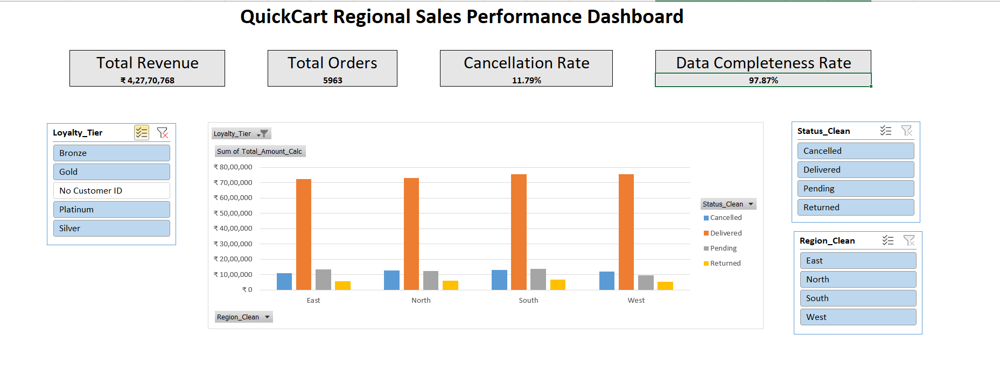
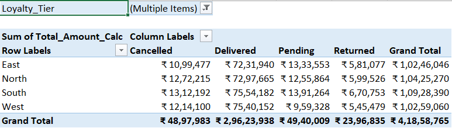

# QuickCart Regional Sales Performance Dashboard

An end-to-end Excel project where I turned a messy, unusable weekly order export into a clean, live dashboard that regional managers could actually use to make decisions.

## Table of Contents

- [Overview](#overview)
- [Problem 1: Untrustworthy Data](#problem-1-the-data-could-not-be-trusted-yet)
- [Problem 2: Missing Revenue](#problem-2-nobody-could-tell-what-the-actual-revenue-was)
- [Problem 3: Unreadable Codes](#problem-3-the-data-was-just-codes-nothing-a-manager-could-read)
- [Problem 4: Preventing Future Mess](#problem-4-the-same-mess-would-just-come-back-next-week)
- [Problem 5: No Live Reporting](#problem-5-there-was-no-live-way-to-actually-look-at-this-data)
- [Final Numbers](#final-numbers)
- [Workbook Structure](#workbook-structure)
- [Skills Demonstrated](#skills-demonstrated)
- [Screenshots](#screenshots)
- [About the Dataset](#about-the-dataset-full-disclosure)
- [Author](#author)

---

## Overview

I received a raw weekly sales export that looked unusable at first glance: no revenue column, region names spelled five different ways, duplicate rows, blank rows, and prices sometimes stored as text with a currency symbol attached. Customer and product information was reduced to ID codes — nothing a manager could actually read.

My job was to take that mess and turn it into something a business user could open, filter, and immediately understand. Below is a walkthrough of every problem I ran into and exactly how I solved it, written in plain language rather than textbook definitions.

---

## Problem 1: The data could not be trusted yet

**What was wrong**
The sheet had 40 completely empty rows scattered randomly among real data, and 186 rows that were exact duplicates of each other. On top of that, the Region, Payment Method, and Order Status columns had the same value typed in five or six different ways — "North," "north," "NORTH," "North " with a trailing space, even "N." as a shortcut.

**How I fixed it**
I never touched the original file directly — I worked on a copy, so I always had the messy version as proof of the "before" state. I filtered for blank rows and deleted them, then ran Excel's Remove Duplicates tool across every column, which cleared out the 186 repeated rows. For the messy text columns, TRIM and PROPER alone weren't enough since some entries were abbreviations or genuine spelling mistakes, so I layered in IF logic to catch those specific cases and map everything back to one clean, correct value.

---

## Problem 2: Nobody could tell what the actual revenue was

**What was wrong**
The Total Amount column was completely empty for every row. Worse, Quantity and Unit Price weren't reliable inputs either — some were missing, some had text like "Rs." stuck in front of the number, and a few even had negative values from apparent typing mistakes.

**How I fixed it**
I built cleaned versions of Quantity and Unit Price first, stripping out currency text and forcing everything into real numbers, and correcting negative values with ABS. I then calculated Total Amount as Quantity × Unit Price, wrapped so that if either input was missing, it wouldn't throw an error or silently skip the row — it would show 0 and get flagged in a separate column as "Incomplete." That way I never lost sight of how much of the total was based on real numbers versus missing data.

---

## Problem 3: The data was just codes, nothing a manager could read

**What was wrong**
Every order only referenced a Customer ID like "C1572" and a combined product code like "SKU P1002 ELE Pro" — meaningless to anyone trying to understand which customers or products actually drive revenue.

**How I fixed it**
First, I split the product code into its individual pieces (Product ID, category, variant) using text functions, since the code always followed the same pattern. Then I used XLOOKUP to pull in the actual product name, category, and price from the Products sheet. For customer info, I deliberately used INDEX + MATCH instead — partly to demonstrate I understand both approaches and when each one makes sense, since INDEX + MATCH works in older Excel versions and doesn't break if columns get rearranged later. Any row with a missing Customer ID got a clear "No Customer ID" label instead of a confusing error, so that gap stayed visible rather than hidden.

---

## Problem 4: The same mess would just come back next week

**What was wrong**
Cleaning the data once doesn't stop someone from typing "north" by hand again next week when new orders come in.

**How I fixed it**
I built a small Reference List sheet holding the correct spelling for every Region, Payment Method, and Status, then applied Data Validation dropdowns on those columns pointing at that reference list. Going forward, whoever enters new data can only pick from the approved list instead of free-typing something inconsistent.

---

## Problem 5: There was no live way to actually look at this data

**What was wrong**
Someone had to manually rebuild a summary report every single week for regional managers — slow, and easy to get wrong.

**How I fixed it**
I converted the cleaned data into a proper Excel Table so it grows automatically as new rows are added. I then built a Pivot Table breaking revenue and order count down by Region and Status, added Slicers for Region, Status, and Loyalty Tier so anyone can filter with one click, and linked a Pivot Chart so the visual updates live too. On top, I added four KPI cards summarizing Total Revenue, Total Orders, Cancellation Rate, and Data Completeness Rate — that last one specifically to be upfront about how much of the data had missing customer info, instead of quietly hiding it.

---

## Final Numbers

| Metric | Value |
|---|---|
| Total Revenue | Rs 4,27,70,768 |
| Total Orders | 5,963 |
| Cancellation Rate | 11.79% |
| Data Completeness Rate | 97.87% |
| Duplicate Rows Removed | 186 |
| Blank Rows Removed | 40 |

## Workbook Structure

| Sheet | What It Holds |
|---|---|
| Orders | Main cleaned, calculated, and enriched transaction data |
| Customers | Clean customer master list |
| Products | Clean product master list |
| Reference_Lists | Approved dropdown values used for Data Validation |
| Dashboard_Data | The Pivot Table behind the dashboard |
| Dashboard | Final KPI cards, chart, and slicers |

## Skills Demonstrated

- **Data cleaning at scale** — removing duplicates and blanks, standardizing inconsistent text entries across thousands of rows
- **Defensive formula design** — calculations that degrade gracefully (flagging "Incomplete" instead of erroring or hiding gaps)
- **Multi-table lookups** — XLOOKUP and INDEX + MATCH used deliberately, matched to the right context
- **Data governance** — Data Validation dropdowns to prevent future inconsistency at the point of entry
- **Dashboard building** — Pivot Tables, Pivot Charts, Slicers, and KPI cards designed for a non-technical audience
- **Transparency in reporting** — surfacing data quality (Completeness Rate) rather than masking it

## Screenshots

### Final dashboard

### Pivot table detail

## About the Dataset (Full Disclosure)

The dataset used in this project is AI-generated synthetic data, not real transaction data from an actual company. I want to be upfront about that rather than let anyone assume otherwise.

It was created using Python and the Faker library, with realistic Indian names, cities, and product categories, and a fixed random seed so results are reproducible. The messiness in the data — duplicate rows, blank rows, inconsistent text, missing values, text-formatted numbers — was deliberately injected to simulate the kind of real-world data quality problems an analyst actually runs into on the job.

The dataset includes roughly 6,150 order records, 600 customer records, and 180 product records spread across three connected tables, built specifically so I could practice cleaning, validation, cross-table lookups, and dashboard building within one coherent project rather than several disconnected exercises.

Every formula, cleaning decision, and dashboard design choice in this project is my own work, built and verified manually in Excel on top of this dataset.

## Author

**Pusplata Singh**
[LinkedIn](https://linkedin.com/in/pusplatasingh) · pusplatasingh1104@gmail.com
